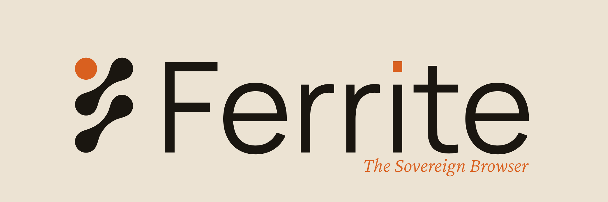

<p align="center">
<picture>
  <source media="(prefers-color-scheme: dark)" srcset="brand/dark_banner_with_tagline.svg">
  
</picture>
</p>

# Ferrite

Ferrite is a privacy-first desktop browser written in Rust (`wry` + `winit`).
Every tab routes through a local loopback proxy; filtering and threat checks
run before any upstream byte is fetched. There is no extension API to bypass,
and private tabs keep everything in memory-only stores.

Device sync is end-to-end encrypted (per-device Ed25519 identities, CRDT
deltas the server never decrypts) over LAN, or anywhere through a
self-hosted relay. Pairing is an explicit code exchange with your approval;
nothing syncs before it.

## Architecture

```
ferrite-browser (binary) -> ferrite-shell (window, ferrite://chrome UI, all IPC)
  -> ferrite-tabs (tab lifecycle, webviews, bounded IPC, ferrite:// pages)
  -> ferrite-omnibox (classification, search engines, local-first autocomplete)
  -> ferrite-proxy (tokio + httparse, blind CONNECT, no MITM)
  -> ferrite-privacy (verdicts: filters, threat intel, headers, page scripts)
  -> ferrite-vault / ferrite-credentials (encrypted storage, passwords, TOTP)
  -> ferrite-archive (offline snapshots) + ferrite-pdf-renderer (isolated child)
  -> ferrite-sync (CRDT sync: LAN QUIC/mTLS + WebSocket relay client)
  -> relay/ (Go relay server: opaque signal routing + TTL blob store)
```

The proxy owns its `tokio` runtime on a dedicated thread. The shell holds
`ProxyHandle` and an `Arc<PrivacyEngine>` as `DecisionHook`. If the proxy is
wanted but unusable at boot, the first tab parks on an error page instead of
browsing direct.

Storage is SQLCipher-backed in release builds; without the `sqlcipher`
feature, keyed stores refuse to open rather than fall back to plaintext.

## Requirements

- Rust 1.96.0 (pinned in `rust-toolchain.toml`; `rustup` picks it up automatically)
- Windows 10/11, or Linux X11 (Wayland builds behind a compile gate and is behaviorally untested; macOS paths are largely unverified)
- Go 1.27+ (only for `relay/`)

## Run

```powershell
cargo run -p ferrite-browser
$env:FERRITE_PORT=18944; cargo run -p ferrite-browser   # fixed proxy port
$env:RUST_LOG="ferrite=debug"; cargo run -p ferrite-browser
```

```powershell
cargo build --release --features ferrite-vault/sqlcipher,ferrite-archive/sqlcipher
```

Debug builds run on plaintext SQLite; release builds require the `sqlcipher`
features and fail closed without them (enforced by build scripts, not convention).

## Test

Mirrors `.github/workflows/ci.yml`:

```powershell
cargo fmt --all --check
cargo clippy --workspace --all-targets --all-features -- -D warnings
cargo test --workspace --all-features
cd relay; go vet ./...; go test ./...
```

## Configuration

| Variable | Effect |
|---|---|
| `FERRITE_PORT` | Fixed proxy port (random if unset) |
| `FERRITE_DATA_DIR` | Data root override (vault, settings, session, threat DB) |
| `RUST_LOG` | Tracing filter (default `ferrite=debug,info`) |
| `FERRITE_RELEASE_ROOT` | Update signing root (or baked `FERRITE_RELEASE_ROOT_BAKED`); updates fail closed without it |

## Relay (off-LAN sync)

Without a relay, sync reaches only devices on the local network (mDNS
discovery). With one, paired devices sync anywhere, through ciphertext the
relay cannot read. The relay holds no accounts and logs no IPs; its only
disk state is a bounded, expiring blob store for offline devices.

```powershell
cd relay
go build -o ferrite-relay .
$env:FERRITE_RELAY_PUBLIC_IP="<this host>"
./ferrite-relay
```

Or deploy the included `relay/Dockerfile` (`render.yaml` holds a one-click
Blueprint for Render's free tier). Then set the relay URL on each device
under Settings → Sync → Off-LAN relay (`wss://<host>/sync`), and pair in
both directions so each device trusts the other.

| Variable | Effect |
|---|---|
| `PORT` | Listen port (`8080` if unset; hosts like Render assign it) |
| `FERRITE_RELAY_PUBLIC_IP` | Required; the process exits without it |
| `FERRITE_RELAY_DATA_DIR` | Blob store dir (`./ferrite-blobs` if unset) |
| `FERRITE_RELAY_ALLOWED_ORIGINS` | Exact-match allowlist for browser origins (native clients send none) |

## Status

Working: windowed shell and tabs (suspend/discard, groups, workspaces),
omnibox, proxy choke with filter/threat verdicts, encrypted vault/archive/
credentials, LAN device sync with QR/code pairing, relay client and server,
signed updates with rollback, per-category sync controls, live theming.

Known gaps: no project-operated relay (the default relay hostnames are
unprovisioned — self-host); discovery is mDNS-only, so client-isolated
networks find no peers (reported honestly, not silently); DoH is off by
default; no extension system, by design.

See `CONTRIBUTING.md` for workflow and `SECURITY.md` for reporting.

## License

MIT OR Apache-2.0 (see `Cargo.toml`; per-file notices in `LICENSES/`).
